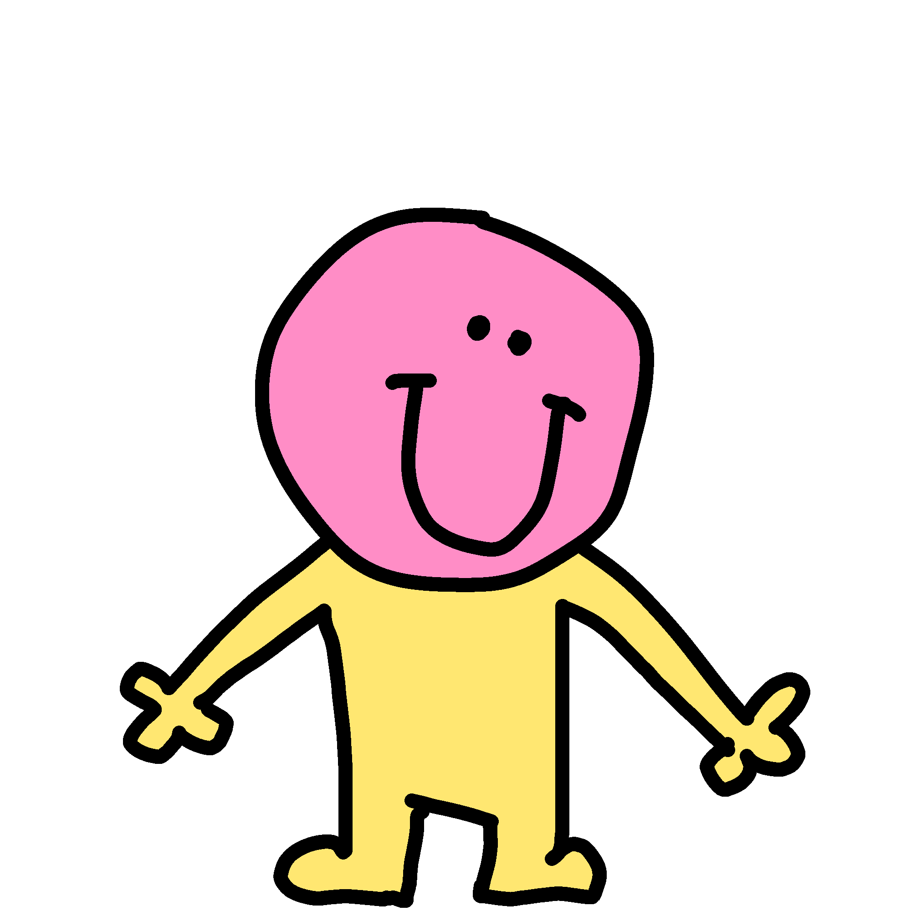

# Critterville



A tiny town of little guys who walk around and do things. There isn't much to do except watch — it's something to leave running.

The town starts as an empty meadow: trees, a pond, a few flowers. The critters build everything else themselves — first a campfire, then houses (no two quite alike), a swing set and a pool — and a few more move in until it's a small, settled town. There are no scores. The **journal** button opens the town's diary (who moved in, what got built, what was painted) a shows page (the town's songs, each with a play button, and the playbills of its plays), a fish book (a picture and a few true facts about each kind of fish the critters have caught), and a night-sky page for what the night owls find through the telescope.

The critters:

- talk to each other, and not just noises: news of what's happened spreads from critter to critter, along with fish stories that grow in the telling, last night's dreams, and compliments
- make friends with whoever they talk to most, and sometimes go off to swim, fish or swing together
- swing on the swing set
- swim in the pool
- make sculptures: stone and wooden statues that gather moss, ones carved from a fallen star that glow, sandcastles that the next rain washes away, piles of found things, and working pieces (a sundial, a weathervane, a birdbath that fills in the rain, a bench to sit on)
- hang hats on statues, lean on them, leave flowers at their feet, and strike the same pose
- add stones to a cairn by the water, clip trees into shapes, and chip away for weeks at one big shared monument
- sometimes paint over an old picture, or take old art down, so the town doesn't silt up
- occasionally move away (everyone comes to wave them off), or set off on an adventure with a knapsack and come back days later with stories to tell and paint
- let what's on their mind into what they make: last night's dream or something seen through the telescope can turn up as a painting, a carving, or the hat they ask the hatmaker for
- make paintings of what they can see from the easel: sometimes the whole view, sometimes a close-up or portrait, a colour-washed version, or something abstract (and go admire each other's)
- dance, sometimes in groups
- play with the ball: pass it round a ring and count, keep it up with their heads, whack it with a stick, push it along, balance on it, juggle; once in a while a good game gets a name and a silly rule and becomes one of the town's own, played again and again (they're listed on the journal's shows page)
- fish in the pond or the stream (a town has one or the other, sometimes both), plant flowers, pick apples
- build the campfire, houses (and later add chimneys, side rooms and upstairs; a bigger house has room for a friend or two to move in), a bridge, the swing set, a fish tank and the pool
- jump the stream until there's a bridge, then mostly use that
- keep a few of the fish they catch in the tank for a while, and come by to watch them
- string a hammock between two trees, two houses, or a house and a tree, if a pair happens to be the right distance apart, and take turns lying in it
- include one prankster, who now and then puts on a jester's hat and fills the pool with apples, paints a house in zigzags or zebra stripes, draws moustaches on statues, throws the ball onto a roof or changes the town's name; the others good-naturedly put it all right (the ball comes down when someone lobs apples at it)
- make themselves instruments (no two sound alike), make up tunes that become the town's songs, and play them in the evening, alone or together in parts, while the others listen and dance
- gather at the campfire in the evening and go home to sleep at night, except for the one or two night owls, who set up a telescope, fish in the dark, follow fireflies, and sleep in

Every day or three something rare happens that leaves the town a little different: a shower brings up flowers (and a rainbow), a shooting star lands and stays as a glowing stone, a windy spell leaves a seedling that grows into a new tree, a duck family moves onto the water, a ring of mushrooms appears and everyone dances in it, or a bag of extra balls turns up for a day. Every few days they build a stage and put on a play about something that really happened in town, with a twist added (a dragon, a ghost, a duel), in costume, in front of everyone; then they take the stage down again. Now and then there's a picnic, a hat blows away and gets brought back, a postcard arrives from someone who left, or a rumour goes round about something big in the water. Sometimes a traveller wheels a cart into town for a few days: a hatmaker (critters keep their hats), a balloon seller, or an ice cream cart.

You can tap a critter to say hi, tap a house to see who lives there, tap a painting to see it up close, or tap the ground to drop a snack. There's also a little ♪ radio button that plays a lofi internet radio stream (the critters dance more when it's on); the stations are listed in `src/config.js`. The town is saved in your browser, so it's still there when you come back.

## Which build am I looking at?

Click the "Critterville" title to show a small `build N`: the version the page is actually running. GitHub Pages lets browsers cache files for about ten minutes, so after an update the page checks for itself and shows a "build N is out: reload" button if it's behind. In the console, `critterville.version` gives the same number.

The number lives in `src/version.js`. Bump it by one whenever you commit a change.

## Running it

No build step and no dependencies: it's plain ES modules drawn on a canvas. Serve the folder with anything, for example:

```bash
python3 -m http.server 8000
```

then open http://localhost:8000. Add `?speed=10` to the URL to fast-forward time.

A few things are there to poke at from the browser console:

- `critterville.trigger('rain')` makes a rare event happen now. The ids are `rain`, `star`, `wind`, `ducks`, `ring`, `cart`, `farewell`, `adventure`, `picnic`, `rumour`, `theatre` and `balls`.
- `critterville.status()` says what's being built, how far along the monument is, and what each critter is doing.
- `critterville.version` is the build number.

## Checking it still works

The game needs no install, but the checks do (Node 24):

```
npm install
npm run check
```

- `npm run lint` looks for plain mistakes: a name that doesn't exist, an import nobody uses.
- `npm test` boots the real game against a pretend browser and fast-forwards three brand new towns (phone, laptop and tablet sized) through 30 days each. It fails if anything throws, a critter gets stuck for two days or wanders off somewhere impossible, or a town doesn't survive being saved and loaded. `node test/smoke.mjs 60 7` runs 60 days with random seed 7.

Both run on every push (`.github/workflows/check.yml`). The test can't see the screen, so it catches crashes and stuck logic, not things that only look wrong.

## How the code is laid out

```
index.html
css/style.css
src/
  main.js            boot, resize, frame loop
  config.js          tunables, palettes, names
  state.js           the one shared world object + time of day
  util.js            maths and random helpers
  ui.js              stats line, event log, hint, the build number
  version.js         which build this is
  talk.js            news, friendships, plans, dreams: what critters say to each other
  puffs.js           little puffs of dust and sawdust
  input.js           tapping critters, dropping snacks
  journal.js         the town's diary and fish records
  journalPanel.js    the journal you open and read
  data/fish.js       fish species and their facts
  data/sky.js        planets and constellations and their facts
  data/plays.js      the plots, parts and twists plays are made from
  radio.js           the lofi radio button, and the sound on/off button
  audio.js           the synthesiser behind the critters' instruments
  data/music.js      making up instruments and songs
  draw/
    primitives.js    wobbly hand-drawn shapes ("line boil")
    critter.js       drawing a critter and its speech bubble
    scenery.js       houses, trees, pond, stream, pool, swing set, artworks...
    fish.js          fish doodles
    sky.js           pictures of planets and constellations for the journal
    sculpture.js     statues, topiary, the monument
    site.js          the pile of materials beside a building site
    stage.js         the theatre and its backdrops
    costume.js       what the cast wears
    instrument.js    the critters' home-made instruments
    cart.js          travellers' carts, hats and balloons
    props.js         things events leave behind, and hammocks
    render.js        one frame: depth sort, day/night wash, glows
  world/
    geometry.js      obstacles and finding empty spots
    town.js          generating a town; factories for houses and critters
    save.js          localStorage save/load
  sim/
    core.js          the critter brain: states, activities, walking
    world.js         clock, ball, growth, new arrivals
  activities/        one module per thing a critter can do
  events/            one module per rare event (rain, a shooting star, a cart, a play...)
test/smoke.mjs       fast-forwards whole towns to check nothing breaks
```

### Adding something for critters to do

Each file in `src/activities/` exports an activity:

```js
export default {
  id: 'nap',
  weight: c => 1,                 // how appealing right now (0 = not possible)
  start(c) { goTo(c, x, y, () => setAct(c, 'nap', 10)); },
  states: {
    nap: {
      pose(c, p) { p.eyesClosed = true; },   // optional hooks: update, finish, pose, props, transform, after
    },
  },
};
```

Register it in `src/activities/index.js` and critters will start doing it. The hooks are documented at the top of `src/sim/core.js`.
